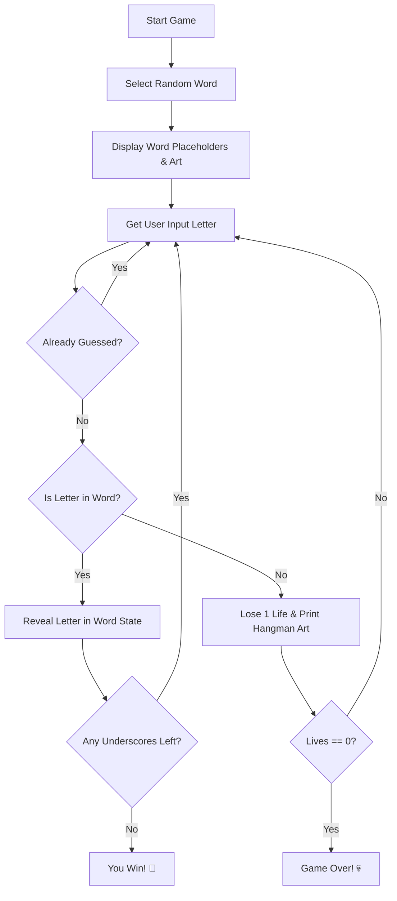

# Day 07 Project: Hangman Game

A command-line implementation of the classic Hangman game featuring ASCII art graphics, modular assets, duplicate input tracking, and dynamic word state updates.

## Objective

Apply and integrate core programming concepts learned across the first week, including:
- **Flow Control:** While loops, nested conditionals, and break conditions.
- **Data Structures:** Lists, string manipulation, and enumeration (`enumerate`).
- **Modularization:** Creating and importing custom modules (`art.py`) to keep code clean and organized.
- **Game Logic:** Managing player lives, tracking guessed letters, and mapping character indices.

## Game Rules & Logic Flow

1. **Initialization:** The computer selects a random fruit from a predefined list. Underscores (`_`) are generated based on the word length.
2. **Guessing:** The player inputs a letter. Input is automatically sanitized (`.strip().lower()[0]`).
3. **Validation:** 
   - If the letter was already guessed, the player is warned (no penalty).
   - If correct, the underscores are replaced with the letter in its respective positions.
   - If incorrect, the player loses 1 life and a stage of the Hangman ASCII art is rendered.
4. **Win/Loss Condition:** The game loops until the player reveals the whole word (Win) or runs out of the 6 attempts (Loss).

### Game Flowchart



## How to Run the Code
```bash
python main.py
```