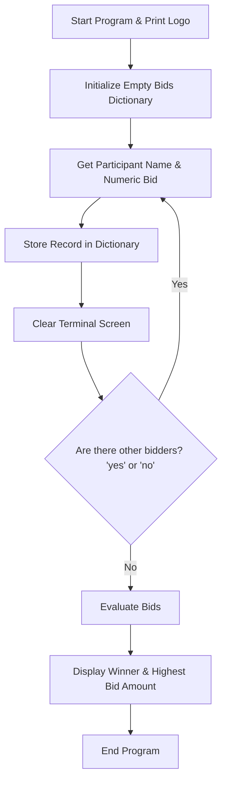

# Day 09 Project: Silent Auction Program

A command-line application that allows multiple participants to submit blind bids for an item, automatically tracking entries, clearing the terminal between turns, and calculating the highest bidder.

## Objective

Apply and expand core programming concepts from **Day 09** of the course, focusing on:
* **Python Dictionaries:** Creating, updating, and structuring key-value data mappings.
* **Nesting & Data Structures:** Structuring records and handling dictionary items dynamically.
* **System Automation:** Managing terminal outputs using the `os` module.

## Logic Flow

1. **Initialization:** The program welcomes participants and displays the secret auction ASCII art logo.
2. **Bid Collection:** Each bidder inputs their name and a valid numeric bid value. The entry is securely stored in a dictionary.
3. **Screen Clearing:** The console clears (`cls`/`clear`) after each submission to preserve confidentiality before passing the device to the next user.
4. **Loop & Termination:** The prompt asks if there are other bidders. Typing `'no'` ends the collection phase.
5. **Winner Announcement:** The application evaluates all recorded bids, identifies the highest amount using functional programming, and declares the winner.

</br>



## How to Run the Code
```bash
python main.py
```